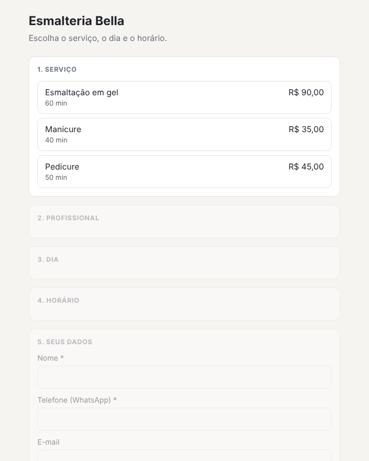
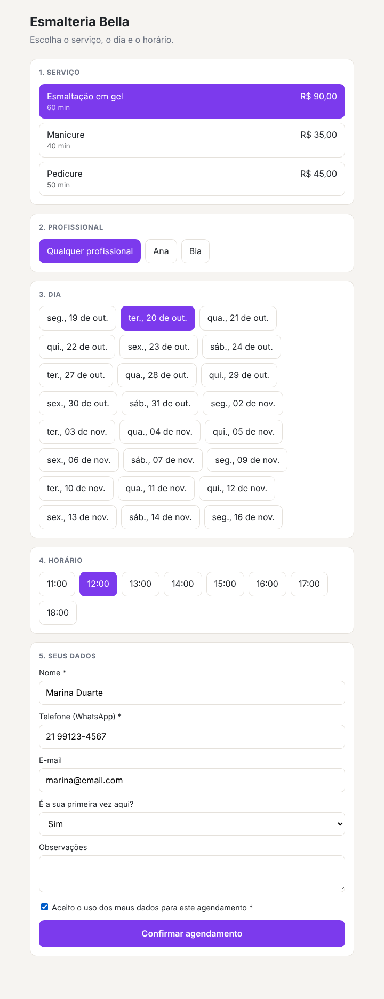
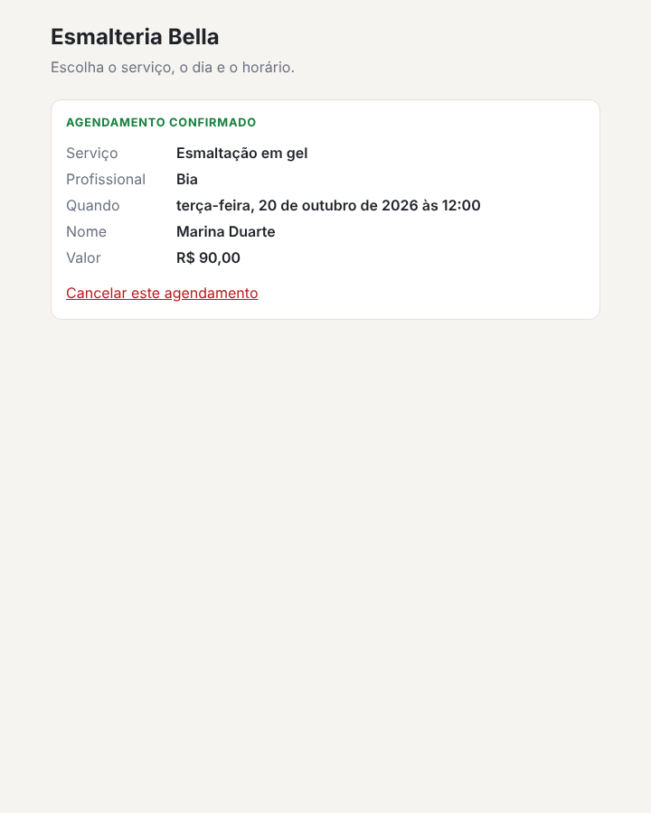
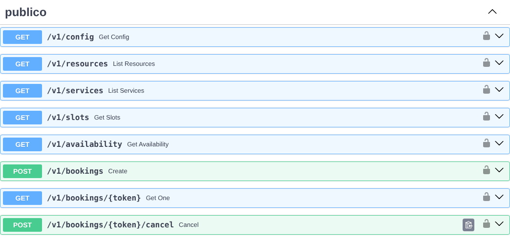
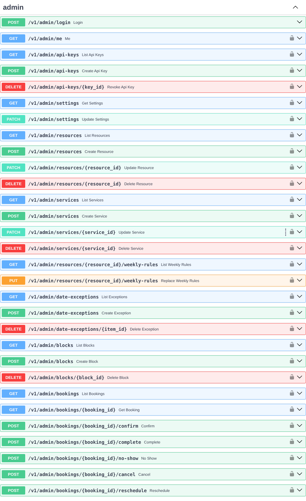
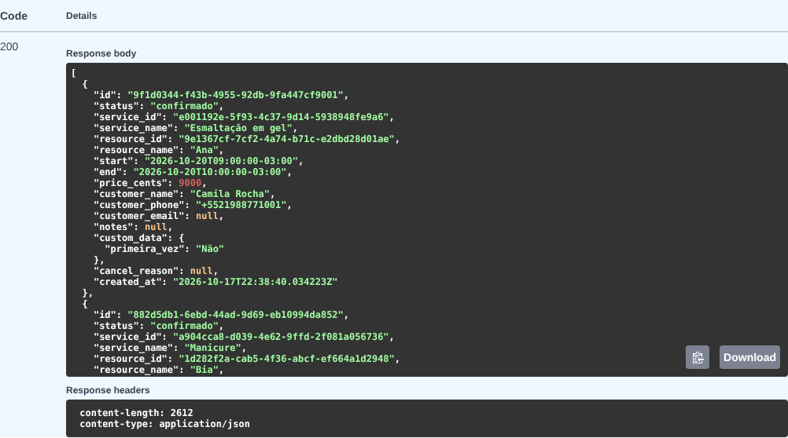

# Agendamento API

Backend de agendamento multi-tenant, feito para ser consumido por vários sites front end (landing pages, sites institucionais, lojas) através de uma API HTTP. O dono de cada negócio define as datas e os horários disponíveis, e o front end só consulta a API para exibir e criar agendamentos.

Status: o fluxo completo funciona e está coberto por testes automatizados: consulta de horários, criação, consulta e cancelamento de agendamentos pelo cliente, e a área do dono para configurar tudo. Faltam o deploy em produção e os itens da fase 2 (WhatsApp, e-mail, lembretes).

## Como rodar localmente

Com Docker:

```
docker compose up --build
```

A API sobe em `http://localhost:8000` (documentação em `/docs`) e as migrations rodam na inicialização.

Sem Docker (precisa de um PostgreSQL 14+ local):

```
python -m venv .venv && source .venv/bin/activate
pip install -e ".[dev]"
cp .env.example .env        # ajuste DATABASE_URL
alembic upgrade head
uvicorn app.main:app --reload
pytest                      # aplica as migrations no banco configurado e roda os testes
python -m app.cli create-tenant --help
```

## Demonstração

O repositório traz uma página de exemplo (`examples/agendar.html`) e um script que monta um negócio fictício (uma esmalteria com duas profissionais) usando a própria API. É a base para o botão de agendamento dos sites dos clientes: a página só conhece a URL da API e a chave do site.

```
uvicorn app.main:app --reload                   # terminal 1
python examples/seed_demo.py                    # terminal 2: cria o negócio e imprime a chave
python -m http.server 5500 --directory examples # terminal 3
# abra http://localhost:5500/agendar.html?key=<chave impressa>
```

Passo a passo do cliente no site. Os dias e horários vêm de `GET /v1/availability` e `GET /v1/slots`, e o formulário é montado a partir de `GET /v1/config`:







Documentação interativa gerada pela API (em `/docs`):





Resposta real de `GET /v1/admin/bookings` (agenda do dono, com telefone e dados do formulário):



Os dados dos prints são fictícios.

## Objetivo

- Fornecer um único backend que atenda vários negócios (tenants) e vários front ends.
- Permitir que o dono defina a disponibilidade: horário semanal, exceções por data e bloqueios pontuais.
- Calcular os horários livres e evitar agendamento duplo, mesmo com requisições simultâneas.
- Ser agnóstico de front end: qualquer site consome a API com uma chave pública.

## Stack

- Python 3.12+
- FastAPI com Pydantic para validação e documentação automática (Swagger/OpenAPI)
- PostgreSQL
- SQLAlchemy 2.0 e Alembic (migrations)
- zoneinfo e python-dateutil para fuso horário e regras recorrentes
- APScheduler para lembretes e jobs agendados (fase 2)
- slowapi para rate limit
- pytest para testes, com foco no motor de slots
- Hospedagem: Render (API) e Supabase (PostgreSQL). Detalhes na seção Hospedagem e ambientes

## Conceitos

### Multi-tenant

Cada site ou cliente é um tenant.

- Tabela `tenants` com nome, fuso horário, configurações e domínios permitidos (CORS).
- Cada tenant tem uma API key pública, usada pelo front end para buscar horários e criar agendamentos.
- O dono acessa a área administrativa com JWT.
- Todas as tabelas carregam `tenant_id` e toda consulta filtra por ele.

### Recursos (profissionais)

Cada tenant tem um ou mais recursos (barbeiros, salas, mecânicos). A tabela `resources` existe desde o início, mesmo que o tenant comece com um só. Se o cliente não escolher um recurso, o backend atribui o primeiro livre.

### Disponibilidade

A disponibilidade é a combinação de três camadas:

1. Horário semanal recorrente. Exemplo: segunda a sexta, 09:00-12:00 e 14:00-18:00.
2. Exceções por data. Feriados, folgas e dias com horário especial. A exceção sobrescreve a regra semanal.
3. Bloqueios pontuais. O dono bloqueia um intervalo específico.

Modo opcional: datas abertas manualmente, em que só existem horários nos dias que o dono publicou.

Parâmetros por serviço:

- Duração do serviço (`duration_minutes`)
- Intervalo entre os inícios dos horários oferecidos (`slot_interval_minutes`). Se não informado ou igual a 0, é igual à duração (um atendimento logo após o outro, sem folga)
- Intervalo entre atendimentos (buffer, `buffer_minutes`)
- Antecedência mínima e máxima para agendar
- Capacidade por horário (uma pessoa ou várias)

O dono ajusta duração, intervalo entre inícios e buffer em passos de 10 minutos. A regra é garantida no banco por constraints (`mod(valor, 10) = 0`) e o passo fica centralizado em `TIME_STEP_MINUTES`, em `app/core/constants.py`. Exemplos válidos: duração de 40 ou 70 minutos, intervalo de 0 (igual à duração) ou 20 minutos, buffer de 0 ou 10 minutos. Valores como 25 ou 45 minutos, e números negativos, são rejeitados.

### Cálculo dos horários

Os horários livres são calculados na hora da consulta. O banco guarda apenas as regras e os agendamentos. Quando o front end pede os slots de um dia, o backend monta a grade, subtrai exceções, bloqueios e agendamentos existentes e devolve os livres.

O cálculo fica em `app/services/slots.py`, como funções puras (sem ORM nem banco), o que permite testar todas as regras sem PostgreSQL. Regras, na ordem em que são aplicadas, para uma data local do tenant e um recurso:

1. **Janelas do dia.** Uma exceção `closed` (do recurso ou do tenant inteiro) fecha o dia. Exceções `custom_hours` substituem a regra semanal, e as do próprio recurso têm prioridade sobre as válidas para o tenant todo. No modo `open_dates`, dias sem `custom_hours` ficam sem horários. Nos demais casos vale a regra semanal. Janelas sobrepostas são unidas.
2. **Candidatos.** A partir do início de cada janela, de `slot_interval_minutes` em `slot_interval_minutes`, enquanto o atendimento inteiro couber na janela. A conta é feita em UTC somando durações reais, então dias de mudança de horário de verão saem corretos e horários próximos da meia-noite continuam na data local do tenant.
3. **Filtros.** Antecedência mínima e máxima (o limite máximo é inclusivo); bloqueios pontuais (consideram só o atendimento, sem o buffer); agendamentos ativos, comparando o intervalo ocupado do candidato (atendimento mais buffer) com o de cada agendamento, a mesma semântica da constraint de exclusão do banco. O buffer, portanto, protege os dois lados de um agendamento existente.
4. **Capacidade.** Serviços com capacidade maior que 1 aceitam vários agendamentos de turma no mesmo início, até o limite de vagas, e informam as vagas restantes. Qualquer outro agendamento sobreposto no recurso bloqueia o horário.
5. **Vários recursos.** `slots_for_service` junta os recursos: cada horário aparece uma vez, com a lista dos recursos livres. O recurso atribuído quando o cliente não escolhe é o primeiro livre, na ordem informada.

A checagem do motor serve para mostrar horários. A garantia contra agendamento duplo continua sendo a constraint do banco, porque duas requisições simultâneas podem ver o mesmo horário livre.

### Concorrência

- Constraint de exclusão no PostgreSQL (`EXCLUDE USING gist` com `tstzrange`) impede agendamentos sobrepostos para o mesmo recurso. O intervalo protegido vai do início do atendimento até `occupied_until` (fim do serviço mais o buffer, calculado pelo backend). Agendamentos cancelados não ocupam o horário.
- Serviços com capacidade maior que 1 (aulas, turmas) gravam `is_exclusive = false` e ficam fora dessa constraint. A lotação deles é controlada na aplicação, sob lock.
- Header `Idempotency-Key` no `POST /v1/bookings` evita duplicidade por clique duplo ou retry.
- Reserva temporária (hold) de 5 a 10 minutos fica como opção futura, útil quando houver pagamento.

### Fuso horário

- Datas e horas são guardadas em UTC (`timestamptz`).
- Cada tenant tem seu fuso (ex.: `America/Sao_Paulo`), e as regras semanais são interpretadas nele.
- A API responde em ISO 8601 com offset.

### Estados do agendamento

`pendente`, `confirmado`, `concluido`, `cancelado` e `nao_compareceu`.

A confirmação é configurável por tenant (`auto_confirm`). Padrão: confirmação automática. O espaço para `aguardando_pagamento` fica reservado para uma fase futura.

## Dados do cliente no agendamento

Obrigatórios:

| Campo | Descrição |
|---|---|
| `service_id` | Serviço agendado |
| `start_at` | Horário escolhido. O backend revalida se ainda está livre |
| `name` | Nome do cliente |
| `phone` | Telefone (WhatsApp) |

Opcionais, configuráveis por tenant:

- `email`
- `notes`
- `resource_id`, quando o cliente pode escolher o profissional
- Campos customizados (ex.: placa do carro para oficina, data de nascimento para clínica)
- `consent_lgpd`, com data e hora do aceite

Configuração de campos por tenant:

```json
{
  "required_fields": ["name", "phone"],
  "optional_fields": ["email", "notes"],
  "custom_fields": [
    { "key": "car_plate", "label": "Placa", "type": "text", "required": true }
  ]
}
```

O front end lê essa configuração em `GET /v1/config` e monta o formulário. O backend valida contra a mesma configuração.

Exemplo de requisição:

```json
POST /v1/bookings
Idempotency-Key: 7c1f...
{
  "service_id": "srv_123",
  "start_at": "2026-10-20T14:00:00-03:00",
  "customer": {
    "name": "Joao Silva",
    "phone": "+5521999999999",
    "email": "joao@email.com"
  },
  "custom": { "car_plate": "ABC1D23" },
  "notes": "",
  "consent_lgpd": true
}
```

A resposta traz `booking_id`, `status` e um `token` para o cliente consultar ou cancelar depois sem precisar de conta.

Os dados do cliente ficam na tabela `customers`, única por `tenant_id` e telefone. O agendamento referencia o cliente, o que permite histórico e limite de agendamentos ativos por pessoa.

Princípio: pedir o mínimo necessário, em respeito à LGPD e à conversão das landing pages.

## API

### Pública (header `X-API-Key` + origem permitida)

| Método | Rota | Descrição |
|---|---|---|
| GET | `/v1/config` | Configuração de campos e regras do negócio |
| GET | `/v1/resources` | Profissionais/agendas ativos |
| GET | `/v1/services` | Serviços disponíveis, com os profissionais que atendem cada um |
| GET | `/v1/availability?service_id=&from=&to=` | Dias com vaga (máximo de 62 dias) |
| GET | `/v1/slots?service_id=&date=` | Horários livres do dia, no fuso do negócio |
| POST | `/v1/bookings` | Cria um agendamento (header opcional `Idempotency-Key`) |
| GET | `/v1/bookings/{token}` | Consulta um agendamento |
| POST | `/v1/bookings/{token}/cancel` | Cancela um agendamento |

`resource_id` é opcional em `/slots` e `/availability`: sem ele, o horário aparece uma vez com a lista de profissionais livres.

Regras do `POST /v1/bookings`:

- O horário precisa ser um dos devolvidos por `/slots` (conferido de novo no servidor, com a reserva travada por serviço). Dois pedidos simultâneos para o mesmo horário: um recebe `201` e o outro `409`.
- Repetir a mesma `Idempotency-Key` devolve o agendamento original (`200`) em vez de duplicar.
- Telefone é normalizado para E.164 (sem `+`, assume Brasil). O cliente é único por telefone dentro do negócio.
- Campos, obrigatoriedade e campos personalizados vêm do `form_config` do negócio. Duração e preço vêm do serviço, nunca do pedido.
- Máximo de 3 agendamentos ativos e futuros por telefone.
- O status inicial é `confirmado` ou `pendente`, conforme `auto_confirm` do negócio.
- Erros de regra voltam como `{"detail": "...", "code": "..."}` (por exemplo `slot_unavailable`, `rate_limited`).

### Administrativa (JWT do dono)

Login em `POST /v1/admin/login` (slug do negócio, e-mail e senha). As demais rotas usam `Authorization: Bearer <token>`.

| Método | Rota | Descrição |
|---|---|---|
| GET | `/v1/admin/me` | Dados do usuário logado |
| GET, PATCH | `/v1/admin/settings` | Nome, fuso, modo de disponibilidade, confirmação automática, antecedência mínima, antecedência máxima, sites permitidos e campos do formulário |
| GET, POST | `/v1/admin/api-keys` | Lista e cria chaves de API (a chave completa só aparece na criação) |
| DELETE | `/v1/admin/api-keys/{id}` | Revoga uma chave |
| GET, POST | `/v1/admin/resources` | Lista e cria profissionais |
| PATCH, DELETE | `/v1/admin/resources/{id}` | Edita, desativa ou remove (bloqueado se houver agendamentos futuros) |
| GET, POST | `/v1/admin/services` | Lista e cria serviços (duração, intervalo e folga em múltiplos de 10 minutos) |
| PATCH, DELETE | `/v1/admin/services/{id}` | Edita ou remove (bloqueado se houver agendamentos futuros) |
| GET, PUT | `/v1/admin/resources/{id}/weekly-rules` | Horário semanal; o `PUT` troca tudo de uma vez |
| GET, POST | `/v1/admin/date-exceptions` | Dias fechados ou com horário especial |
| DELETE | `/v1/admin/date-exceptions/{id}` | Remove a exceção |
| GET, POST | `/v1/admin/blocks` | Bloqueios pontuais de horário |
| DELETE | `/v1/admin/blocks/{id}` | Remove o bloqueio |
| GET | `/v1/admin/bookings` | Agendamentos, com filtros `status`, `date_from`, `date_to`, `resource_id` |
| GET | `/v1/admin/bookings/{id}` | Detalhe, com telefone e dados do formulário |
| POST | `/v1/admin/bookings/{id}/confirm` | Pendente para confirmado |
| POST | `/v1/admin/bookings/{id}/complete` | Confirmado para concluído |
| POST | `/v1/admin/bookings/{id}/no-show` | Confirmado para não compareceu |
| POST | `/v1/admin/bookings/{id}/cancel` | Cancela e libera o horário |
| POST | `/v1/admin/bookings/{id}/reschedule` | Remarca para outro horário livre (e, opcionalmente, outro profissional) |

### Como o dono ganha acesso

Não existe cadastro aberto. Quem opera a plataforma cria o negócio e o login do dono (e-mail e senha) e entrega ao cliente:

```
python -m app.cli create-tenant --name "Esmalteria da Ana" --slug esmalteria-ana \
    --owner-email ana@exemplo.com --owner-password 'uma-senha-forte' \
    --origin https://esmalteriadaana.com.br
```

O comando cria o negócio, uma agenda padrão, o dono e a primeira chave de API (exibida uma única vez). A chave vai no front end do site; o dono usa o login para configurar serviços e horários.

## Aviso ao dono pelo WhatsApp Business (adiado para a fase 2)

Decidido, mas deixado para depois do fluxo principal de agendamento. Definição:

Quando um agendamento é concluído, a API envia uma mensagem ao WhatsApp Business da empresa com: nome e telefone do cliente, dia e horário marcados e o serviço escolhido (e o profissional, quando houver mais de um).

- O envio usa a WhatsApp Business Platform (Cloud API da Meta). O aplicativo comum do WhatsApp Business não tem API, então o número da empresa precisa estar cadastrado nessa plataforma.
- Como a empresa recebe a mensagem sem ter falado antes com o número da API, o envio usa um modelo de mensagem (template) aprovado pela Meta.
- Por negócio ficam configurados: número que recebe os avisos, identificador do número na Meta e token de acesso (guardado criptografado).
- O aviso não pode atrasar nem derrubar o agendamento: o pedido de envio é gravado na mesma transação do agendamento (tabela de saída) e um processo separado envia, com novas tentativas em caso de falha. Se o WhatsApp estiver fora do ar, o agendamento continua válido e o aviso sai depois.
- Cancelamentos e remarcações geram um aviso próprio.
- Fase 2 (continua valendo): confirmação e lembrete por WhatsApp ao cliente.

## Segurança

- Chave de API guardada só como hash SHA-256; senha com scrypt; JWT HS256 com expiração
- Com `ENV=production` a API não sobe sem um `JWT_SECRET` de 32+ caracteres
- Se a requisição traz `Origin`, ele precisa estar em `allowed_origins` do negócio (lista vazia bloqueia navegadores). Chamadas de servidor, sem `Origin`, só precisam da chave. O CORS da aplicação fica aberto de propósito, e essa verificação é feita no servidor por negócio
- Limite de requisições por IP (padrão: 10 por minuto no login e na criação de agendamento), em memória. Atrás do proxy do Render vale `TRUSTED_PROXY_HOPS=1`; confirme o valor no primeiro deploy, porque ele decide qual IP do `X-Forwarded-For` é usado. Com mais de uma instância o limite passa a ser por instância
- Validação de entrada com Pydantic; honeypot (`website`) no `POST /v1/bookings`
- Limite de agendamentos ativos por telefone
- Duração e preço sempre recalculados no backend
- Dois negócios nunca enxergam dados um do outro (todas as consultas filtram por `tenant_id`)
- Verificação de telefone por OTP: fase 2, opcional por negócio

## Modelo de dados

`tenants`, `admin_users`, `api_keys`, `resources`, `services`, `service_resources`, `weekly_rules`, `date_exceptions`, `blocks`, `customers`, `bookings`

Observações:

- `admin_users` guarda o login do dono (e-mail e hash de senha) para emitir o JWT.
- `api_keys` guarda apenas o hash SHA-256 da chave, mais um prefixo para identificação. A chave completa só é exibida na criação.
- `service_resources` define quais recursos executam cada serviço.
- `date_exceptions` tem dois tipos: `closed` (dia fechado) e `custom_hours` (horário especial). No modo `open_dates` do tenant, são as linhas `custom_hours` que abrem os dias.
- Chaves primárias são UUID. Tenants, recursos e serviços usam soft delete (`deleted_at`).

## Estrutura de pastas

```
agendamento-api/
├── app/
│   ├── main.py
│   ├── cli.py            # create-tenant, expire-pending
│   ├── deps.py           # resolve o negócio pela chave de API e o dono pelo JWT
│   ├── core/             # config, segurança, rate limit, erros
│   ├── db/               # sessão, base
│   ├── models/
│   ├── schemas/          # Pydantic
│   ├── services/
│   │   ├── slots.py      # motor de cálculo de horários (puro, sem banco)
│   │   ├── loader.py     # carrega do banco o que o motor precisa
│   │   ├── booking.py    # criar, cancelar e remarcar
│   │   └── forms.py      # validação contra o form_config
│   └── routers/
│       ├── public/
│       └── admin/
├── examples/             # página de agendamento e script de demonstração
├── docs/img/             # prints do README
├── tests/
├── alembic/
├── render.yaml           # blueprint do Render (API + job de expiração)
├── pyproject.toml
└── Dockerfile
```

## Roadmap

1. Modelos e migrations (concluído)
2. Autenticação: API key pública e JWT do dono (concluído)
3. Motor de slots com testes (regra semanal, exceções, bloqueios, buffer, antecedência, fuso) (concluído)
4. Endpoints públicos de consulta (concluído)
5. `POST /bookings` com constraint de exclusão e idempotência (concluído)
6. Endpoints administrativos (concluído)
7. Rate limit, honeypot e blueprint do Render (concluído); falta publicar no Render e no Supabase
8. Fase 2: aviso ao dono pelo WhatsApp Business, e-mail e WhatsApp ao cliente, lembretes, webhooks, OTP, sincronização com Google Calendar, pagamento/sinal, botão de agendamento embutível para os sites

## Hospedagem e ambientes

| Parte | Onde | Motivo |
|---|---|---|
| API FastAPI | Render (Web Service, via Dockerfile) | Processo sempre ligado, deploy automático a cada push no GitHub, variáveis de ambiente e logs |
| Banco | Supabase (PostgreSQL) | Suporte à extensão `btree_gist` (constraint anti-sobreposição de horários), backups e painel SQL |
| Lembretes e jobs (fase 2) | Render Cron Job | Evita rodar o APScheduler dentro da API, o que duplicaria jobs com mais de uma instância |
| Domínio | `api.seudominio.com` apontando para o Render | URL estável mesmo se a hospedagem mudar |

Ambientes:

- Desenvolvimento: Docker Compose local com PostgreSQL.
- Produção: Render + Supabase, com migrations executadas no deploy (`alembic upgrade head`). O `render.yaml` descreve o web service e um job de hora em hora (`python -m app.cli expire-pending`) que cancela agendamentos pendentes que passaram do horário sem confirmação. A `DATABASE_URL` do Supabase é informada no painel do Render.

Decisões e cuidados:

- A Vercel não hospeda esta API (modelo serverless, sem processo contínuo para jobs e com atrito de pool de conexões). Ela fica reservada para os front ends que consomem a API.
- O plano gratuito do Render hiberna a API após inatividade e o do Supabase pausa o projeto. Servem para desenvolvimento e demonstração; produção com cliente real usa plano pago.
- A conexão do SQLAlchemy com o Supabase usa a conexão direta ou o pooler em modo sessão. O pooler em modo transação (porta 6543) costuma dar problema com prepared statements no driver assíncrono.
- Segredos (chave do JWT, URL do banco, chave de e-mail) ficam apenas nas variáveis de ambiente do Render, nunca no repositório.
- Alternativa simplificada: web service e Render Postgres na mesma plataforma, com rede interna e uma conta só.

## Fora do escopo desta etapa

- Painel administrativo visual (a gestão é feita pela API/Swagger; a página em `examples/` é só um exemplo de uso)
- Pagamento e sinal
- Integração com calendários externos

## Licença

Distribuído sob a licença MIT. Veja o arquivo [LICENSE](LICENSE).
